# Social Network Analysis Project
## Time-Aware Network Centrality: Measures & Link Prediction

This project focuses on the algorithmic manipulation of the Stack Overflow Temporal Network, whose description and related dataset
may be found on the link below.

Dataset Link: https://snap.stanford.edu/data/sx-stackoverflow.html

Each edge of the underlying graph is associated with a timestamp, indicating the exact time instance where the edge was created.

The complete set of directional edges for the aforementioned network, along with the associated timestamps,
is row-wise stored in the file `sx-stackoverflow.txt` as consecutive triplets of the form `(source_id, target_id, timestamp)`. 

## Packages

- pandas
- networkX
- matplotlib
- random
- numpy

# Part One
## Time Period Partitioning

The complete time period, as described in Part 1, has been partitioned on 10 equal duration periods.
It gives enough temporal resolution to observe evolution while keeping the subsequent centrality analysis.

Time boundaries have also been calculated for 10 equal duration periods.

## Subgraph Representation

In order to define the subgraph representation, a fixed number of edges has been determined,
so that each time period has different edges.

    T1: 813,739 edges
    T2: 1,895,644 edges
    T3: 2,942,326 edges
    T4: 4,890,511 edges
    T5: 6,263,519 edges
    T6: 7,873,629 edges
    T7: 9,481,054 edges
    T8: 9,935,186 edges
    T9: 9,282,517 edges
    T10: 10,118,925 edges

The number of total assigned edges as well as the number of original edges is 63497050, with no difference between each other.

The most common choice for a graph is a NetworkX graph, since there are undirected graphs in the dataset.

The number of nodes in the file are 32888, and the number of edges is 496620 with no self-loops.
Note that the file contains timestamped edge records, which means that the timestamp is no longer stored on the edge.

Since the graph is already clean, the temporal graphs have been created.

## Time Evolution Graph

After creating the temporal graphs, a graph depicting the time evolution for each time period has been provided.
Each time period has different nodes and edges.

    T1: 32,888 nodes, 496,620 edges
    T2: 91,139 nodes, 1,012,026 edges
    T3: 187,011 nodes, 1,470,491 edges
    T4: 319,421 nodes, 2,305,798 edges
    T5: 423,668 nodes, 2,895,693 edges
    T6: 572,267 nodes, 3,516,687 edges
    T7: 748,973 nodes, 4,255,052 edges
    T8: 854,705 nodes, 4,406,668 edges
    T9: 928,934 nodes, 4,145,454 edges
    T10: 1,024,422 nodes, 4,474,425 edges

### Evolution on Number of Nodes

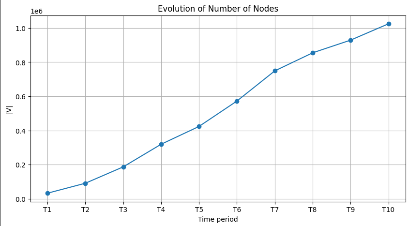

### Evolution on Number of Edges

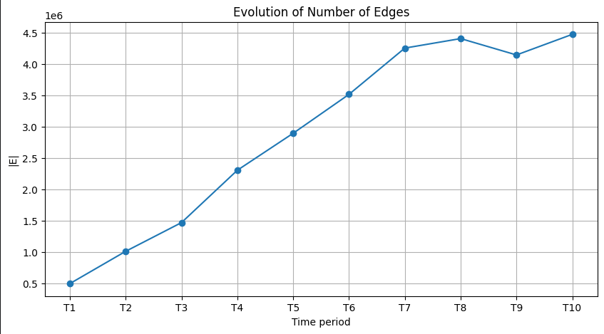

## Probability Density Functions and Centralities
### Degree Centrality

The degree centrality for all time periods has been calculated and plotted for each period distribution.

### Degree Centrality Distribution Across All Time Periods

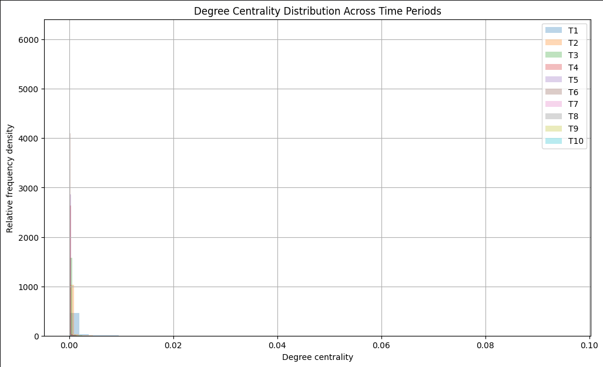

### Closeness Centrality

The closeness centrality for all time periods has been calculated and plotted for each period distribution.

Note that closeness centrality is much more computationally expensive than degree centrality,
thus a fixed number of samples has been used for calculation.

### Closeness Centrality Distribution Across All Time Periods

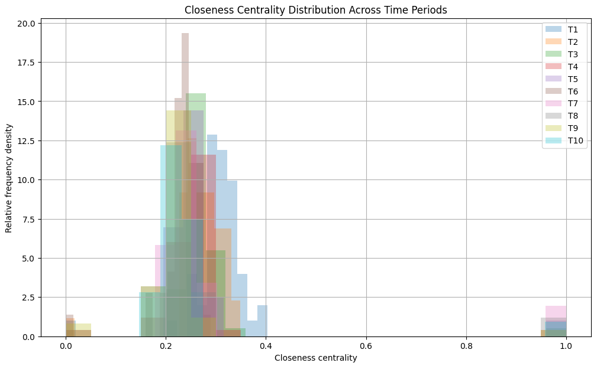

### Sampled Betweenness Centrality

Before testing on all ten nodes, betweenness centrality has been tested on one node first.
Later, it was calculated for all ten nodes on each period.

Therefore, it was plotted for each period distribution.

### Sampled Betweenness Centrality Distribution Across All Time Periods

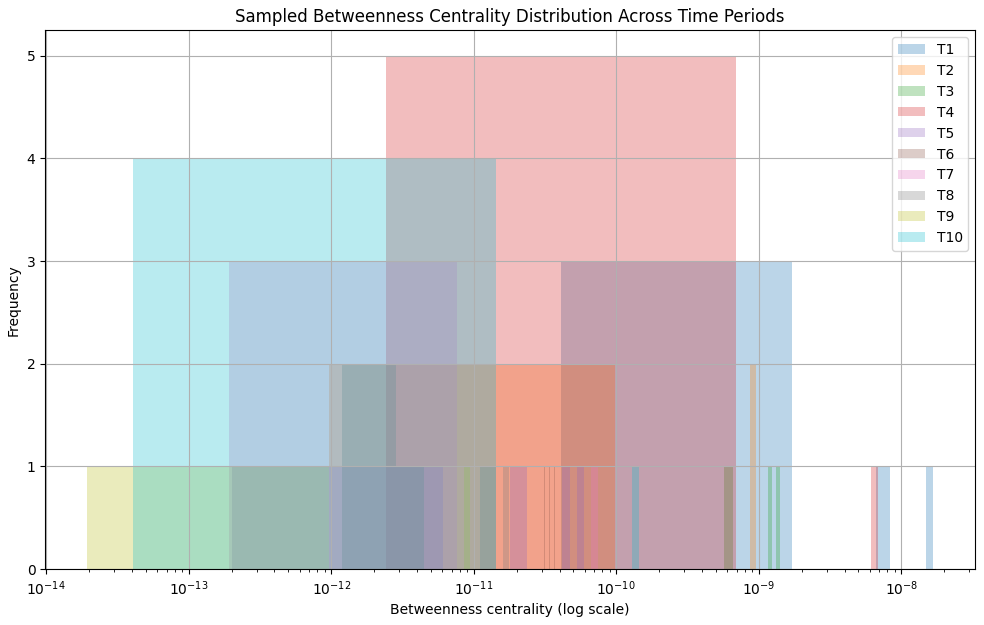

### Eigenvector Centrality

Before testing on all ten nodes, eigenvector centrality has been tested on one node first.
Later, it was calculated for all ten nodes on each period.

Therefore, it was plotted for each period distribution.

### Eigenvector Centrality Distribution Across All Time Periods

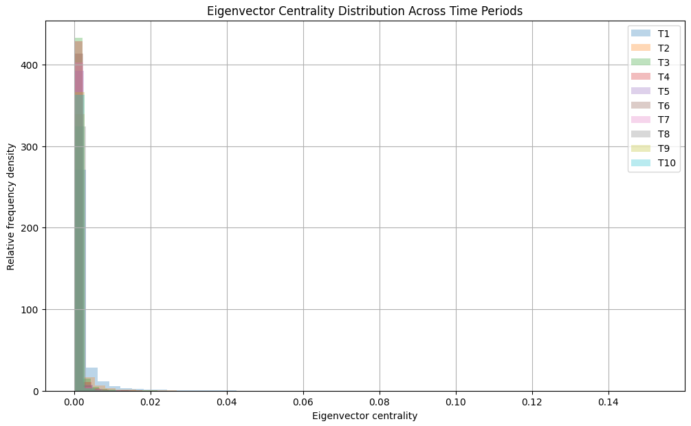

### Katz Centrality

Lastly, Katz centrality has been calculated for one node on a fixed number of nodes.
Later, it was calculated for all ten nodes on each period.

Note that Katz centrality can be computationally more sensitive because it involves solving an iterative system.

Therefore, it was plotted for each period distribution.

### Katz Centrality Distribution Across All Time Periods

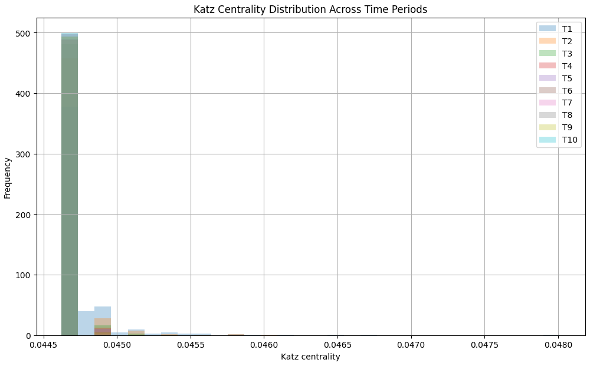

# Part Two
## Link Measures

For link measures to be achieved, the same 10 time periods as well as the 10 temporal undirected graphs, both from part 1,
have been recreated.

The number of persistent nodes between each pair has been calculated.

    T1 → T2: 24,781 persistent nodes
    T2 → T3: 54,874 persistent nodes
    T3 → T4: 95,659 persistent nodes
    T4 → T5: 155,775 persistent nodes
    T5 → T6: 229,295 persistent nodes
    T6 → T7: 306,353 persistent nodes
    T7 → T8: 379,034 persistent nodes
    T8 → T9: 420,915 persistent nodes
    T9 → T10: 460,709 persistent nodes

as well as the number of persistent edges.

    T1 → T2: |E*_1| = 453,910, |E*_2| = 298,615
    T2 → T3: |E*_2| = 873,542, |E*_3| = 579,638
    T3 → T4: |E*_3| = 1,193,006, |E*_4| = 865,608
    T4 → T5: |E*_4| = 1,804,880, |E*_5| = 1,243,077
    T5 → T6: |E*_5| = 2,303,640, |E*_6| = 1,624,896
    T6 → T7: |E*_6| = 2,694,295, |E*_7| = 1,961,770
    T7 → T8: |E*_7| = 3,064,149, |E*_8| = 2,171,307
    T8 → T9: |E*_8| = 2,987,829, |E*_9| = 2,048,912
    T9 → T10: |E*_9| = 2,756,422, |E*_10| = 2,191,718

### Persistent Nodes and Restricted Edges Across Time

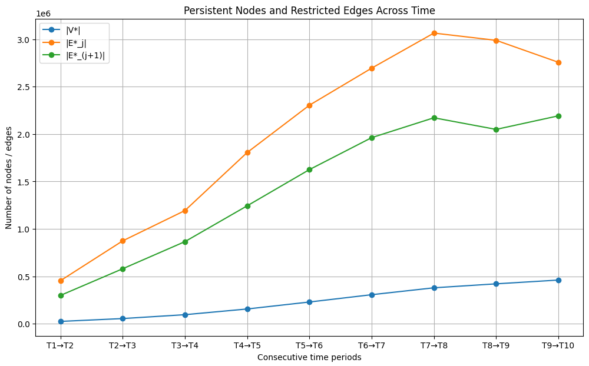

After plotting the nodes and edges, each similarity measure has been calculated on a fixed number of pairs,
in order to reduce computational cost.

## SGD

In SGD (negative geodesic distance), the similarity scores and pairs have been calculated on a fixed number
of pairs. In the current measure, a number of 100,000 pairs was used.

The number of sampled pairs is 99,995, the number of unique sampled pairs is 100,000
and the total number of shortest pairs (SGD pairs) is 99,400.

This was done in order to reduce computational cost.

## SCN

In SCN (common neighbors), no fixed number of pairs was used.
The number of pairs is 99,400.

## SJC

In SJC (Jaccard similarity of common neighbors), no fixed number of pairs was used.
The number of pairs is 99,400.

## SA

In SA (Adamic/Adar similarity), no fixed number of pairs was used.
The number of pairs is 99,400.

## SPA

In SPA (preferential attachment), no fixed number of pairs was used.
The number of pairs is 99,400.

Later, the similarity results have been saved in order to be reserved for future deployment, especially during part three.

# Part Three
## Link Prediction

This project also demonstrates to describe and implement a training algorithm
which determines the optimal range sets R∗X for each similarity measure.

The goal of the training algorithm should be the maximization of accuracy within the training set.

For the third and final part of the project, it is important to utilize the similarity results extracted from Part 2, 
as well as read the dataset used in Part 1 and 2.

After loading the dataset, the persistent nodes are defined.
The number of persistent nodes is 24,781.

Later, the training and testing edges are specified, with a number of 453,910 on the training edges 
and 298,615 on the testing edges.

Then, the candidate labels are connected with the training/testing edge sets.
The number of candidate pairs is 99,400, while the training positive pairs are 130 and the testing positive pairs are 82.

As well as the candidate-universe statistics, with a number of 99,400 on 130 training edges,
with a lambda value (λ) of 0.001308.

## Score Distributions
### SGD

Starting with SGD score distributions, the sampled candidate pairs from most similar to least similar have been sorted
and all unique values have been distributed along with their frequencies.

The top 10 SGD scores have been sorted,

    [-1 -1 -1 -1 -1 -1 -1 -1 -1 -1]

as well as distributed to the following values.

    -7: 1
    -6: 76
    -5: 1,621
    -4: 21,450
    -3: 62,973
    -2: 13,149
    -1: 130

Then, SGD range and training edges were compared to see if the shortest-distance range corresponds to the T1 edges 
in the current example.

The pairs with SGD equal to -1 are 130. The same number corresponds to the number of training edges among them.

The training accuracy of SGD is 1.000000.

## SCN

The score distribution of Common Neighbors (SCN) measure is calculated before choosing its optimal range.

Then, the next step is to see how the 130 training-positive pairs are distributed across SCN values.
That will identify which SCN ranges contain the training edges.

The score distributions for SCN are listed below.

    SCN score distribution:
    0: 86,153
    1: 8,179
    2: 2,371
    3: 987
    4: 558
    5: 290
    6: 193
    7: 157
    8: 74
    9: 73
    10: 56
    11: 47
    12: 43
    13: 33
    14: 15
    15: 24
    16: 15
    17: 15
    18: 13
    19: 15
    20: 10
    21: 8
    22: 7
    23: 3
    ...
    63: 1
    66: 1
    67: 1
    99: 1

The SCN scores among training edges are listed below.

    SCN scores among training edges:
    0: 32
    1: 20
    2: 14
    3: 3
    4: 3
    5: 4
    6: 4
    7: 6
    8: 3
    9: 5
    10: 4
    11: 4
    12: 4
    13: 3
    14: 2
    15: 2
    17: 1
    18: 1
    20: 1
    21: 1
    24: 1
    26: 1
    29: 1
    30: 1
    ...
    43: 1
    49: 1
    62: 1
    66: 1

The threshold for SCN has also been calculated to a value of 62.
For accuracy, the threshold number is 0.998682.

Best individual SCN value is 40.
Its accuracy is 0.998702.

Best SCN range has also been calculated and ranges within [40, 40].
Its accuracy value is 0.998702.

## SJC

The score distribution of Jaccard similarity of common neighbors (SCN) measure has been calculated.

The minimum SJC value is 0.000000, the maximum value is 0.500000, its mean value is 0.002054 and its median value is 0.000000.

The number of distinct SJC values among training edges is 94, where the first 20 SJC values among training edges are listed below.

    0.000000: 32
    0.002336: 1
    0.003077: 1
    0.003268: 1
    0.003704: 1
    0.004343: 1
    0.005348: 1
    0.005495: 1
    0.005882: 1
    0.006250: 1
    0.006452: 1
    0.006757: 1
    0.006951: 1
    0.007273: 1
    0.007353: 1
    0.008130: 2
    0.008451: 1
    0.009009: 1
    0.009390: 1
    0.009730: 1

The accuracy for best SJC lower-bound range is 0.998682.

The accuracy for best SJC range with at least one prediction is 0.998682.

Best SJC range is [0.030387, 0.030391] out of 2 predictions.
The accuracy number for best SJC range is 0.998712.

## SA

The minimum SA value is 0.000000, the maximum value is 18.326429, its mean value is 0.050739 and its median value is 0.000000.

The number of distinct SA values among training edges is 99, where the first 20 SA values among training edges are listed below.

    0.000000: 32
    0.125037: 1
    0.152025: 1
    0.159084: 1
    0.159226: 1
    0.159464: 1
    0.159902: 1
    0.167469: 1
    0.175840: 1
    0.191558: 1
    0.194712: 1
    0.200112: 1
    0.216679: 1
    0.217147: 1
    0.223919: 1
    0.226304: 1
    0.230213: 1
    0.240449: 1
    0.248425: 1
    0.292608: 1

Best SA range is [1.646894, 1.647013] out of 2 predictions.
The accuracy number for best SA range is 0.998712.

## SPA

The minimum SPA value is 1, the maximum value is 459000, its mean value is 1236.98 and its median value is 150.

The number of distinct SPA values among training edges is 130, where the first 20 SPA values among training edges are listed below.

    113: 1
    195: 1
    220: 1
    222: 1
    264: 1
    308: 1
    328: 1
    339: 1
    344: 1
    357: 1
    450: 1
    483: 1
    490: 1
    588: 1
    667: 1
    675: 1
    790: 1
    840: 1
    864: 1
    884: 1

Best SPA range is [49856, 50105] out of 2 predictions.
The accuracy number for best SPA range is 0.998712.

The test performance for SPA is based on accuracy value.
Out of 1 false positive and 1 false negative, its accuracy is 0.999175.

## Optimal Ranges Evaluation

Later, all optimal ranges are evaluated on T2, since accuracy is misleading in this case.
Only 130 of 99,400 sampled candidate pairs are training positives.

For SGD, the number of true positives is 7 and false positives is 123.
The accuracy value is 0.998008.

For SCN, the number of true positives is 0 and false positives is 1.
The accuracy value is 0.999165.

For SJC, the number of true positives is 0 and false positives is 1.
The accuracy value is 0.999165.

For SA, the number of true positives is 0 and false positives is 2.
The accuracy value is 0.999155.

For SPA, the number of true positives is 1 and false positives is 2.
The accuracy value is 0.999175.

## Final Results

The final results table has therefore been created and evaluated.

Then, the results have been saved in a clean dataframe.

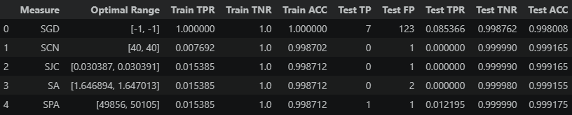

Key results have also been depicted.

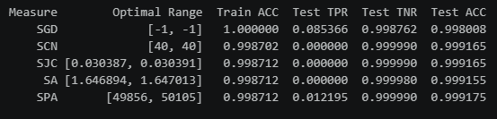

### Plot Training vs. Testing Accuracy

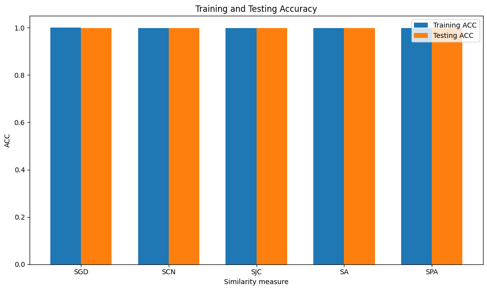

### Plot Precision and Recall

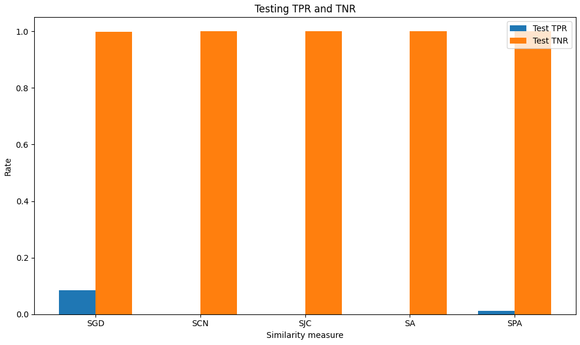
